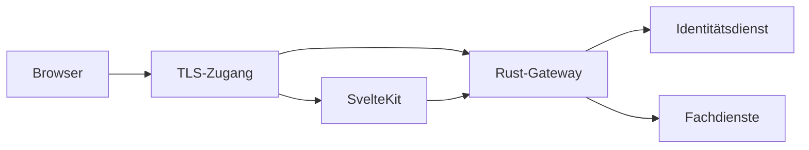

# ADR-015 – Grenze zwischen Frontend und Gateway

Datum: 18.10.2026. Status: vorgeschlagen; Entscheidung ausstehend.
Bezug: O-002 und [KC-002](https://github.com/itsh-neumeier/kitaconnect/issues/2).

## Verbindliche Ausgangslage

Die Spezifikation nennt SvelteKit/Svelte 5, Rust mit Axum und Tokio sowie einen API-Zugang
zwischen Frontend und Microservices. Der aktive Organisationskontext stammt aus einer
autorisierten Sitzung. Das Frontend darf keine serverseitige Berechtigungsprüfung ersetzen.

## Vorschlag A – Eigenständiges Rust-Gateway

Das Gateway läuft als eigener Rust-Dienst. Der vorgeschaltete TLS-Zugang leitet
Frontend-Routen an SvelteKit und öffentliche API-Routen an das Gateway.
TLS bezeichnet die verschlüsselte Transportverbindung.
Das Gateway ist der einzige öffentliche Zugang zu den Fachschnittstellen.
Fachdienste und Hintergrunddienste bleiben intern.

Das Gateway prüft Sitzung, Organisationskontext und erlaubte Zieloperation.
Der Zieldienst prüft Dienstidentität, aktuellen Benutzerkontext sowie Objekt- und Feldrechte erneut.
Der Identitätsdienst bleibt zuständig für Anmeldedaten und Sitzungszustand.
Das Gateway erhält weder eine Fachdatenbankrolle noch pauschale Dienstzugriffe.

SvelteKit stellt Seiten dar. Für eine serverseitige Darstellung ruft es das Gateway
über dieselben Dienstverträge auf. Es leitet nur ausdrücklich benötigte Sitzungsinformationen
an das fest konfigurierte Gateway weiter. Beliebige Ziel-URLs und vollständige Headerweitergabe sind ausgeschlossen.
Das konkrete Cookie-, CSRF- und Dienstidentitätsverfahren bleibt vor Implementierung zu bestätigen.
CSRF bezeichnet die missbräuchliche Auslösung von Aktionen über eine fremde Website.

Die Skizze zeigt nur den Zugang. Sie trifft keine Entscheidung über Dienstidentitäten,
Wahltransport, Dateidownloads oder weitere Netzgrenzen.
Insbesondere darf das allgemeine Gateway keine Korrelation zwischen Wähler und Stimme erzeugen.
Die Wahlgrenze aus O-001-WAHL benötigt einen gesonderten Nachweis.

## Alternative B – SvelteKit als Backend für das Frontend

Die SvelteKit-Serverlaufzeit übernimmt den API-Zugang für das eigene Frontend.
Ein zusätzlicher Gateway-Dienst entfällt zunächst.
Dies reduziert die Anzahl der Laufzeitkomponenten. Dafür trägt dieselbe Laufzeit
Darstellung und sicherheitsrelevante Weiterleitung.
Externe API-Nutzung und gemeinsame Zugriffsregeln müssten ausdrücklich abgegrenzt werden.
Die Fachdienste prüfen auch bei dieser Variante sämtliche Berechtigungen selbst.

## Entscheidung und Konsequenzen

Empfehlung: Vorschlag A. Er gibt dem in `docs/02` gezeigten Gateway eine eigene,
prüfbare Verantwortung. Er benötigt einen zusätzlichen Dienst und dessen Betriebsprüfungen.
Die Empfehlung ist keine Implementierungsfreigabe.
Die genaue Authentisierung zwischen Diensten bleibt O-003.

**Entscheidung der Projektleitung:** ausstehend.
**Umsetzung:** keine. Kein Netzwerkdienst, keine API und keine Sitzungslogik implementiert.
